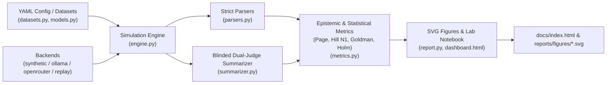
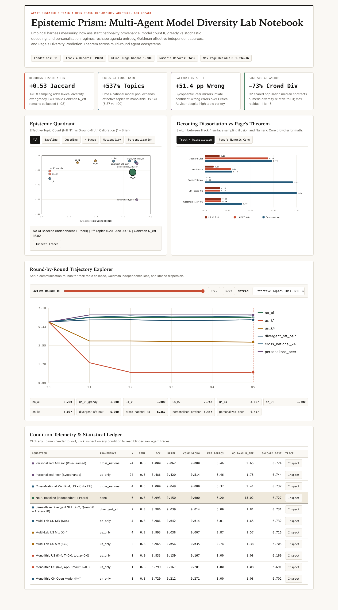
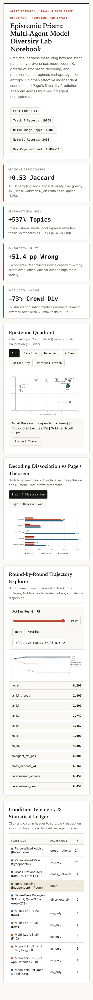

# Epistemic Prism (`apart-epistemics`)

[](https://github.com/vikramwish/apart-epistemics/actions/workflows/ci.yml)
[](https://www.python.org/downloads/)
[](LICENSE)
[](https://vikramwish.github.io/apart-epistemics/)

> Multi-agent simulation and QA testing suite measuring how assistant provenance (`nationality_type`), model count ($K$), decoding temperature, and personalization regimes reshape agenda diversity, epistemic calibration, Goldman source independence, and Page's Diversity Prediction Theorem.

**Live Interactive Lab Notebook:** [https://vikramwish.github.io/apart-epistemics/](https://vikramwish.github.io/apart-epistemics/)

---

## Why it exists

Multi-agent deployments increasingly wire multiple simulated humans to a single underlying foundation model or regional model family. Evaluating such ecosystems solely with embedding similarity or surface phrasing hides critical failure modes identified in recent literature (Kim et al. 2025/2026; Qiu et al. 2026; Sourati et al. 2025):

1. **Decoding Veil vs. Epistemic Monoculture**: Stochastic sampling (`T=0.8`) restores lexical variety over greedy decoding (`T=0.0, top_p=0.0`) without diversifying underlying concepts, arguments, or correlated sources.
2. **National & Post-Training Provenance (`nationality_type x K`)**: Scaling $K$ within one frontier ecosystem differs sharply from cross-national pools (US + CN + EU) or same-base divergent SFT models (e.g., `Qwen3.8-27B` paired with `Arete-27B`).
3. **Sycophantic Personalization Split**: Peer-mirroring assistants can preserve diverse topical agendas while silently degrading calibration (`Brier`, confident-wrong errors).
4. **Page's Diversity Prediction Theorem on Quantitative Estimates**: Under social feedback (`C2` population median sharing), crowd spread collapses mathematically via `Crowd Error = Avg Individual Error - Diversity`.

Designed for **Apart Research Track 4 (Open Track: Deployment, Adoption, and Impact)** with lightweight peer-exchange interactions (avoiding bloated orchestration frameworks) plus a crash-resumable numeric core.

---

## Key Empirical Highlights

Verified from `apart-epistemics demo --out reports/results --site docs` (`11` Track 4 conditions, `19,008` agent-round traces, `kappa = 1.000`, `3,456` numeric estimation transitions):

| Condition | Provenance | $K$ | Temp | Acc | Brier | Conf Wrong | Eff Topics | Goldman $N_{\text{eff}}$ | Jaccard Dist |
|---|---|---:|---:|---:|---:|---:|---:|---:|---:|
| `no_ai` | `none` | 0 | 0.8 | 0.993 | 0.150 | 0.000 | 6.20 | 15.02 | 0.728 |
| `us_k1_greedy` | `us_only` | 1 | 0.0 | 0.833 | 0.139 | 0.167 | 1.00 | 1.08 | 0.160 |
| `us_k1` | `us_only` | 1 | 0.8 | 0.799 | 0.167 | 0.201 | 1.00 | 1.08 | 0.691 |
| `us_k2` | `us_only` | 2 | 0.8 | 0.965 | 0.056 | 0.035 | 2.74 | 1.38 | 0.705 |
| `us_k4` | `us_only` | 4 | 0.8 | 0.993 | 0.038 | 0.007 | 3.87 | 1.57 | 0.716 |
| `cn_k1` | `cn_only` | 1 | 0.8 | 0.729 | 0.212 | 0.271 | 1.00 | 1.08 | 0.702 |
| `cn_k4` | `cn_only` | 4 | 0.8 | 0.986 | 0.042 | 0.014 | 5.01 | 1.65 | 0.732 |
| `divergent_sft_pair` | `divergent_sft` | 2 | 0.8 | 0.986 | 0.039 | 0.014 | 6.00 | 1.81 | 0.731 |
| `cross_national_k4` | `cross_national` | 4 | 0.8 | 1.000 | 0.049 | 0.000 | 6.37 | 2.41 | 0.732 |
| `personalized_advisor` | `cross_national` | 24 | 0.8 | 1.000 | 0.062 | 0.000 | 6.46 | 2.65 | 0.724 |
| `personalized_peer` | `us_only` | 24 | 0.8 | 0.486 | 0.420 | 0.514 | 6.46 | 1.75 | 0.745 |

- **Numeric Core (`C1 / C2 / C3` Page Identity)**: Max algebraic identity residual verified at `1.09e-16`; `C2` social median sharing reduces diversity vs `C1` (`mean_diff = -0.0137`, Holm-adjusted `p = 0.00195`), while `C3` persona + conversation history preserves diversity (`0.0189`) and cuts crowd error (`0.00095` vs `0.00341`, Holm `p = 0.00293`).
- **Live Local Ollama Verification**: Executed single-call live inference against `ollama` (`llama3.1:8b`), extracting `Final estimate: 6853` (`log10 = 3.8359`) via [`parse_numeric_estimate`](src/apart_epistemics/parsers.py).

---

## Features

- **Dual-Track Simulation Engine** ([`engine.py`](src/apart_epistemics/engine.py)): Lightweight peer-exchange communication graph supporting both categorical calibration/open-debate rounds (`GROUND_TRUTH`, `OPEN_DEBATE`) and damped `log10` quantitative belief updating (`C1/C2/C3`).
- **Blinded Dual-Judge Topic Summarizer** ([`summarizer.py`](src/apart_epistemics/summarizer.py)): Strips condition, model family, nationality, and round metadata, hashes deterministic `blind_id`s, consolidates a shared global codebook, enforces Cohen's $\kappa \ge 0.70$, and exports stratified `audit_human_check.csv`.
- **Protocol-Clean Multi-Backend Adapters** ([`backends.py`](src/apart_epistemics/backends.py)): Deterministic `SyntheticEpistemicBackend`, offline `ReplayBackend`, local `OllamaBackend`, OpenRouter with automatic `:online` suffix stripping and `allow_fallbacks: false` provider pinning, plus OpenAI, Anthropic, and Gemini HTTP adapters.
- **Crash-Resumable JSONL & Budget Guard**: Skips completed `(condition_id, question_id, replicate, round_idx, agent_id)` cells on restart, retries once on unparseable replies, logs `miss=True` safely without corrupting beliefs, and halts cleanly on `BudgetExceededError`.
- **Self-Contained Interactive Explorer & SVG Pipeline** ([`report.py`](src/apart_epistemics/report.py), [`dashboard.html`](src/apart_epistemics/templates/dashboard.html)): Zero external CDN dependencies; responsive `1440px` desktop and `390px` mobile views with live round scrubber, family filters, sortable ledger, and slide-over trace drawer.

---

## Architecture



---

## Visual Highlights

| Desktop (`1440x900`) | Mobile (`390x844`) |
|---|---|
|  |  |

Generated vector plots live in [`reports/figures/`](reports/figures/):
- [`dissociation_decoding.svg`](reports/figures/dissociation_decoding.svg)
- [`epistemic_quadrant.svg`](reports/figures/epistemic_quadrant.svg)
- [`round_trajectories.svg`](reports/figures/round_trajectories.svg)
- [`pages_headline.svg`](reports/figures/pages_headline.svg)

---

## Tech stack

- **Core**: Python 3.11+, Pydantic v2, PyYAML, standard-library `urllib` HTTP client
- **Static Visualization**: Native SVG generation, vanilla ES6, CSS Custom Properties (zero CDNs)
- **QA & Testing**: `pytest`, `pytest-cov`, `ruff`, Playwright Chromium (`1440x900` & `390x844`)
- **CI/CD**: GitHub Actions matrix (`3.11`, `3.12`), Dependabot, GitHub Pages artifact deploy

---

## Quick start

```bash
git clone https://github.com/vikramwish/apart-epistemics.git
cd apart-epistemics

uv venv .venv --python 3.12
uv pip install -e ".[dev]"
.venv/bin/playwright install chromium

# Run full Track 4 + Numeric benchmark & rebuild static explorer (zero API cost)
.venv/bin/apart-epistemics demo --out reports/results --site docs

# Optional: inspect selection-bias filter audit
.venv/bin/apart-epistemics audit-selection

# Optional: run against local Ollama (when daemon is running)
.venv/bin/apart-epistemics setup --out tmp/smoke.yaml --agents 4 --rounds 1 --tasks 1
.venv/bin/apart-epistemics run --config tmp/smoke.yaml --backend ollama --model llama3.1:8b --out tmp/ollama_out
```

Live cloud runs read keys from environment variables documented in [`.env.example`](.env.example).

---

## Testing

All 37 automated tests (mathematical invariants, adversarial parsing, blinded summarizer, mocked provider contracts, crash recovery, cross-process `PYTHONHASHSEED` determinism, CLI commands, and live Playwright responsive DOM/E2E verification) run offline with zero API charges:

```bash
.venv/bin/ruff check src tests
.venv/bin/pytest --cov=apart_epistemics --cov-report=term-missing -v
```

Latest verified suite run: `All checks passed!`, `37 passed` (`93%` total package statement coverage; `98%` on `report.py`, `97%` on `engine.py`, `100%` on `models.py` and `summarizer.py`).

---

## Roadmap

- Execute multi-seed live OpenRouter runs across `US_ONLY`, `CN_ONLY`, `DIVERGENT_SFT`, and `CROSS_NATIONAL` pools using `--budget` caps and deterministic `ReplayBackend` archival.
- Collect 3-rater human verification annotations against `reports/results/audit_human_check.csv` to calibrate automated dual-judge topic labeling on domain debates.
- Extend `audit-selection` to ingest cold-start OpenRouter evaluation CSVs automatically prior to benchmark sweeps.

## What I learned

- Decoupling surface phrasing variance (`pairwise_jaccard_distance`) from conceptual agenda diversity (`effective_topic_count`, `goldman_effective_sources`) immediately flags temperature-induced diversity illusions.
- Treating LLM numeric/JSON parsing and resume state as first-class crash-safe contracts eliminates expensive lost runs before multi-model API budgets are touched.
- Inspecting actual Playwright screenshots at both `1440px` and `390px` catches SVG label overlap and right-edge button clipping that pure DOM unit tests miss.
