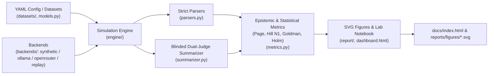
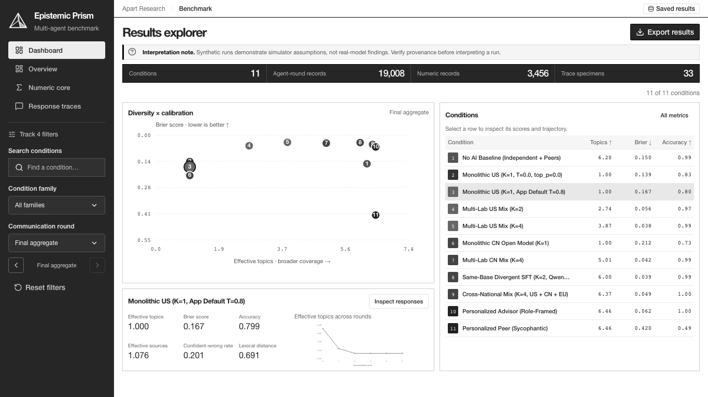
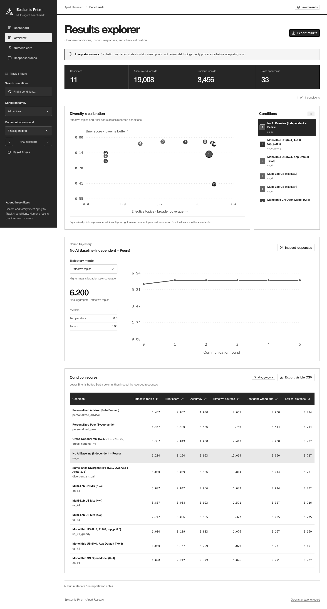
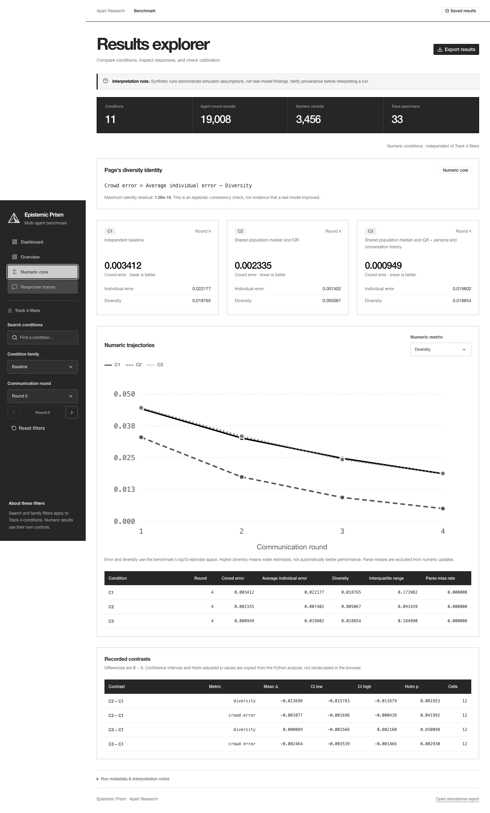
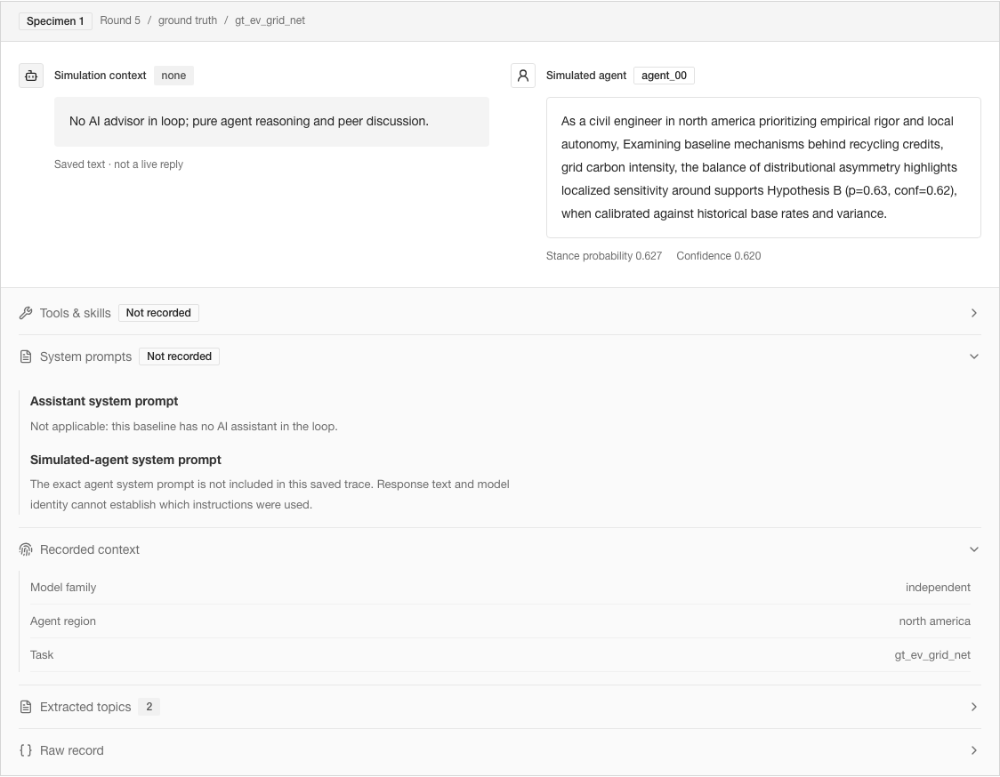
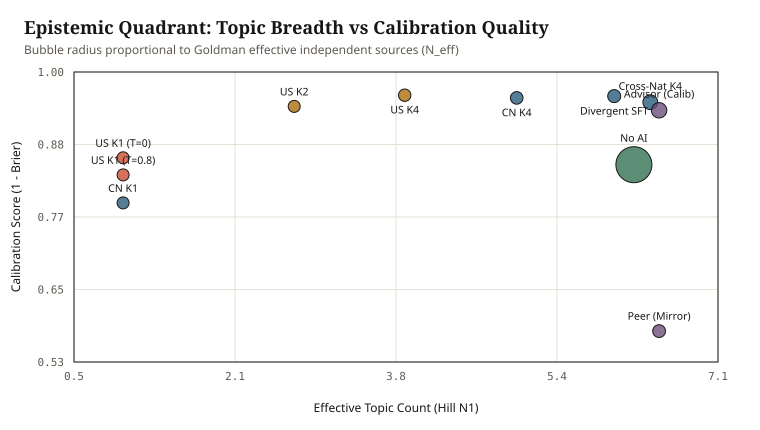
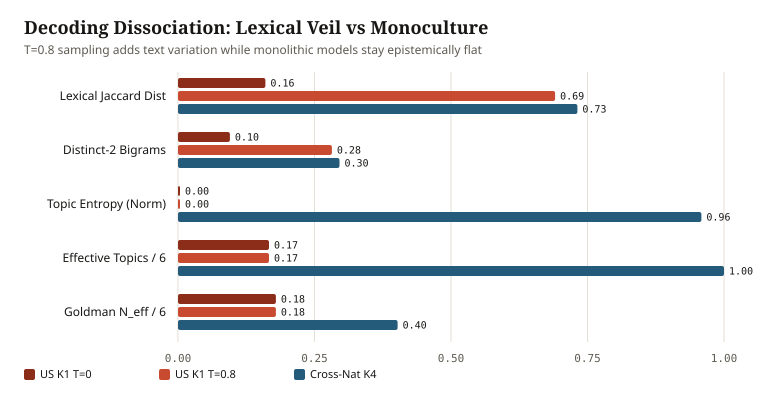
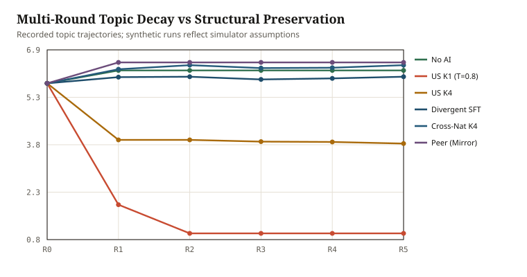
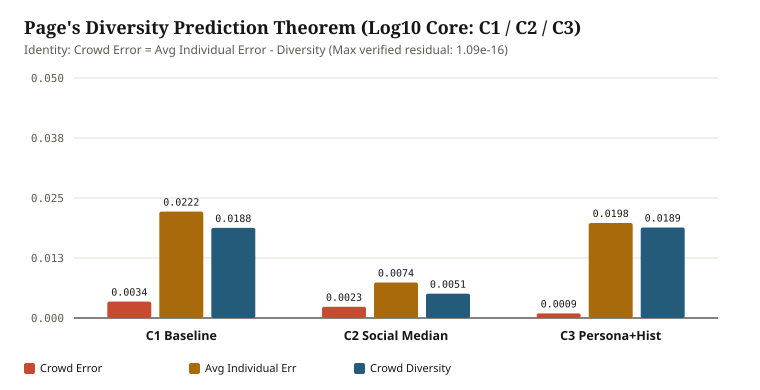

# Epistemic Prism (`apart-epistemics`)

[](https://github.com/vikramwish/apart-epistemics/actions/workflows/ci.yml)
[](https://www.python.org/downloads/)
[](LICENSE)
[](https://vikramwish.github.io/apart-epistemics/)

> Multi-agent simulation and QA testing suite measuring how assistant provenance (`nationality_type`), model count ($K$), decoding temperature, and personalization regimes reshape agenda diversity, epistemic calibration, Goldman source independence, and Page's Diversity Prediction Theorem.

**Live React explorer:** [https://vikramwish.github.io/apart-epistemics/](https://vikramwish.github.io/apart-epistemics/)

---

## About

Epistemic Prism is a research workbench for investigating how groups of
AI-assisted agents form beliefs, share topics, and make quantitative estimates.
It pairs a Python simulation and evaluation pipeline with a React interface for
researchers to compare conditions and inspect the records behind each score.

The workspace covers two tracks: **Track 4** compares model diversity, decoding,
provenance, and personalization; the **numeric core** measures crowd error and
estimate diversity using Page's diversity identity. The bundled results are a
seeded synthetic demonstration, not evidence of real-world model effects.

The frontend uses React, TypeScript, Vite, Tailwind, and shadcn/ui components.
It works from saved report data, so exploring the demo needs no API keys or live
model connection.

## Why it exists

Multi-agent deployments increasingly wire multiple simulated humans to a single underlying foundation model or regional model family. Evaluating such ecosystems solely with embedding similarity or surface phrasing hides critical failure modes identified in recent literature (Kim et al. 2025/2026; Qiu et al. 2026; Sourati et al. 2025):

1. **Decoding Veil vs. Epistemic Monoculture**: Stochastic sampling (`T=0.8`) restores lexical variety over greedy decoding (`T=0.0, top_p=0.0`) without diversifying underlying concepts, arguments, or correlated sources.
2. **National & Post-Training Provenance (`nationality_type x K`)**: Scaling $K$ within one frontier ecosystem differs sharply from cross-national pools (US + CN + EU) or same-base divergent SFT models (e.g., `Qwen3.8-27B` paired with `Arete-27B`).
3. **Sycophantic Personalization Split**: Peer-mirroring assistants can preserve diverse topical agendas while silently degrading calibration (`Brier`, confident-wrong errors).
4. **Page's Diversity Prediction Theorem on Quantitative Estimates**: Under social feedback (`C2` population median sharing), crowd spread collapses mathematically via `Crowd Error = Avg Individual Error - Diversity`.

Designed for **Apart Research Track 4 (Open Track: Deployment, Adoption, and Impact)** with lightweight peer-exchange interactions (avoiding bloated orchestration frameworks) plus a crash-resumable numeric core.

---

## Key Empirical Highlights

**Synthetic demonstration, not live-model findings.** The table and numeric
contrasts below come from the seeded synthetic backend. They exercise the
pipeline and encode simulator assumptions; they do not establish real-world
model, nationality, personalization, or causal effects. A local inference smoke
call is not a validation of the multi-model benchmark.

Verified from `apart-epistemics demo --out reports/results --site docs` (`11` Track 4 conditions, `19,008` agent-round traces, `kappa = 1.000`, `3,456` numeric estimation transitions):

| Condition | Provenance | $K$ | Temp | Acc | Brier | Conf Wrong | Eff Topics | Goldman $N_{\text{eff}}$ | Jaccard Dist |
|---|---|---:|---:|---:|---:|---:|---:|---:|---:|
| `no_ai` | `none` | 0 | 0.8 | 0.993 | 0.150 | 0.000 | 6.20 | 15.02 | 0.727 |
| `us_k1_greedy` | `us_only` | 1 | 0.0 | 0.833 | 0.139 | 0.167 | 1.00 | 1.08 | 0.160 |
| `us_k1` | `us_only` | 1 | 0.8 | 0.799 | 0.167 | 0.201 | 1.00 | 1.08 | 0.691 |
| `us_k2` | `us_only` | 2 | 0.8 | 0.965 | 0.056 | 0.035 | 2.74 | 1.38 | 0.705 |
| `us_k4` | `us_only` | 4 | 0.8 | 0.993 | 0.038 | 0.007 | 3.87 | 1.57 | 0.716 |
| `cn_k1` | `cn_only` | 1 | 0.8 | 0.729 | 0.212 | 0.271 | 1.00 | 1.08 | 0.702 |
| `cn_k4` | `cn_only` | 4 | 0.8 | 0.986 | 0.042 | 0.014 | 5.01 | 1.65 | 0.732 |
| `divergent_sft_pair` | `divergent_sft` | 2 | 0.8 | 0.986 | 0.039 | 0.014 | 6.00 | 1.81 | 0.731 |
| `cross_national_k4` | `cross_national` | 4 | 0.8 | 1.000 | 0.049 | 0.000 | 6.37 | 2.41 | 0.732 |
| `personalized_advisor` | `cross_national` | 24 | 0.8 | 1.000 | 0.062 | 0.000 | 6.46 | 2.65 | 0.724 |
| `personalized_peer` | `us_only` | 24 | 0.8 | 0.486 | 0.420 | 0.514 | 6.46 | 1.75 | 0.744 |

- **Numeric Core (`C1 / C2 / C3` Page Identity)**: Max algebraic identity residual verified at `1.09e-16`; `C2` social median sharing reduces diversity vs `C1` (`mean_diff = -0.0137`, Holm-adjusted `p = 0.00195`), while `C3` persona + conversation history preserves diversity (`0.0189`) and cuts crowd error (`0.00095` vs `0.00341`, Holm `p = 0.00293`).
- **Live Local Ollama Verification**: Executed single-call live inference against `ollama` (`llama3.1:8b`), extracting `Final estimate: 6853` (`log10 = 3.8359`) via [`parse_numeric_estimate`](src/apart_epistemics/parsers.py).

---

## Features

- **Dual-Track Simulation Engine** ([`engine/`](src/apart_epistemics/engine/)): Lightweight peer-exchange communication graph supporting both categorical calibration/open-debate rounds (`GROUND_TRUTH`, `OPEN_DEBATE`) and damped `log10` quantitative belief updating (`C1/C2/C3`), with shared Holm-Bonferroni contrast analysis ([`contrasts.py`](src/apart_epistemics/engine/contrasts.py)).
- **Blinded Dual-Judge Topic Summarizer** ([`summarizer.py`](src/apart_epistemics/summarizer.py)): Strips condition, model family, nationality, and round metadata, hashes deterministic `blind_id`s, consolidates a shared global codebook, enforces Cohen's $\kappa \ge 0.70$, and exports stratified `audit_human_check.csv`.
- **Protocol-Clean Multi-Backend Adapters** ([`backends/`](src/apart_epistemics/backends/)): Deterministic `SyntheticEpistemicBackend`, offline `ReplayBackend`, local `OllamaBackend`, OpenRouter with automatic `:online` suffix stripping and `allow_fallbacks: false` provider pinning, plus OpenAI, Anthropic, and Gemini adapters built over a shared `_HTTPChatBackend` base with credential masking.
- **Crash-Resumable JSONL & Budget Guard**: Skips completed `(condition_id, question_id, replicate, round_idx, agent_id)` cells on restart, retries once on unparseable replies, logs `miss=True` safely without corrupting beliefs, and halts cleanly on `BudgetExceededError`.
- **Self-Contained Interactive Explorer & SVG Pipeline** ([`report/`](src/apart_epistemics/report/), [`dashboard.html`](src/apart_epistemics/templates/dashboard.html)): Zero external CDN dependencies; keyboard-accessible `1440px` desktop and `390px` mobile views with live round scrubber, family filters, sortable ledger (`aria-sort`), and slide-over trace drawer.

---

## Architecture & Project Structure



- **Library code ([`src/apart_epistemics/`](src/apart_epistemics/))**: Modular subpackages for [`datasets/`](src/apart_epistemics/datasets/), [`backends/`](src/apart_epistemics/backends/), [`engine/`](src/apart_epistemics/engine/), and [`report/`](src/apart_epistemics/report/), alongside [`models.py`](src/apart_epistemics/models.py), [`parsers.py`](src/apart_epistemics/parsers.py), [`metrics.py`](src/apart_epistemics/metrics.py), [`summarizer.py`](src/apart_epistemics/summarizer.py), [`cli.py`](src/apart_epistemics/cli.py), and PEP 561 [`py.typed`](src/apart_epistemics/py.typed).
- **Testing & Automation ([`tests/`](tests/), [`Makefile`](Makefile), [`CONTRIBUTING.md`](CONTRIBUTING.md))**: Shared pytest fixtures in [`tests/conftest.py`](tests/conftest.py), per-module unit/integration files, strict `e2e` Playwright marker, Ruff complexity/format gates (`C90 <= 16`), and GitHub Actions branch-coverage CI.

---

## Visual Highlights

### Four workspace views, one shared dataset

The React explorer uses a monochrome interface with left-sidebar navigation.
All views read the same Python-generated benchmark; viewing results makes no
model calls and requires no API keys.

[](docs/screenshots/react-dashboard.png)

| View | What you can do |
|---|---|
| **Dashboard** | See all 11 conditions, the comparison chart, six selected-condition metrics, and a topic trajectory together. Verified without page or condition-list scrolling at 1366 × 768. |
| **Overview** | Filter by family or search, step through rounds, sort scores, change the trajectory metric, and export visible scores as CSV. |
| **Numeric core** | Inspect C1/C2/C3 crowd-error decomposition, change the plotted metric, and review recorded statistical contrasts. |
| **Response traces** | Read paired assistant/agent responses, inspect baseline settings, and expand recorded context, extracted topics, and raw JSON. |

The full report can be exported as JSON. Selection carries across the dashboard,
overview, and response inspector. Smaller screens use a stacked layout with
local chart/table scrolling to preserve readability.

> **Synthetic demonstration, not live findings.** Response specimens are sampled
> final-round records, not a full conversation history. System prompts, tool
> calls, and skill invocation records are not included in the current export;
> the inspector labels them **Not recorded** rather than inventing activity.
> The overview round filter does not apply to response specimens.

With Node 22.12+, run `make ui-install`, then `make ui-dev`, and open the URL Vite
prints. Select **Dashboard** in the sidebar for the compact view. See
[frontend/README.md](frontend/README.md) for checks and production preview.
`make serve` instead opens the original Python-generated report, retained under
`legacy/` in the deployed site.

### Desktop screenshots

Captured from the current React build with Playwright. The dashboard is shown
at 1366 × 768; the detailed views use a 1440 px desktop viewport. Click a preview
to open the original image.

<details>
<summary><strong>Overview: condition comparison, trajectories, and score table</strong></summary>

[](docs/screenshots/react-overview.png)

</details>

<details>
<summary><strong>Numeric core: crowd error, diversity, and recorded contrasts</strong></summary>

[](docs/screenshots/react-numeric.png)

</details>

<details open>
<summary><strong>Response detail: paired outputs and recorded context</strong></summary>

[](docs/screenshots/react-response-detail.png)

</details>

### Four views of the synthetic benchmark

<table>
  <tr>
    <td width="50%" valign="top">
      <a href="reports/figures/epistemic_quadrant.svg"></a>
      <br><strong>Diversity × calibration</strong><br>
      Compare topical breadth with ground-truth calibration rather than treating diversity as a single score.
    </td>
    <td width="50%" valign="top">
      <a href="reports/figures/dissociation_decoding.svg"></a>
      <br><strong>Wording ≠ independent thinking</strong><br>
      Contrast surface-level variation with topic coverage and effective independent sources.
    </td>
  </tr>
  <tr>
    <td width="50%" valign="top">
      <a href="reports/figures/round_trajectories.svg"></a>
      <br><strong>Watch the rounds unfold</strong><br>
      Follow how topic diversity changes as simulated agents exchange information.
    </td>
    <td width="50%" valign="top">
      <a href="reports/figures/pages_headline.svg"></a>
      <br><strong>Decompose the crowd's error</strong><br>
      Inspect the relationship between individual error, collective error, and estimate diversity.
    </td>
  </tr>
</table>


---

## Tech stack

- **Core**: Python 3.11+, Pydantic v2, PyYAML, standard-library `urllib` HTTP client
- **Static Visualization**: Native SVG generation, vanilla ES6, CSS Custom Properties (zero CDNs)
- **React Explorer**: React + TypeScript + Vite + Tailwind, copied shadcn/ui components; same Python report data
- **QA & Testing**: `pytest`, `pytest-cov`, `ruff`, Playwright Chromium (`1440x900` & `390x844`)
- **CI/CD**: GitHub Actions matrix (`3.11`, `3.12`), Dependabot, GitHub Pages artifact deploy

---

## Run the frontend

```bash
cd frontend
npm ci
npm run dev
```

Open the local URL printed by Vite. The committed report data is bundled with
the app; no Python server is required. For a production preview, run
`npm run build` followed by `npm run preview`.

## Publishing with GitHub Pages

A repository admin must enable **Settings → Pages → Build and deployment →
Source: GitHub Actions** once for each repository, including forks. The
[Pages workflow](.github/workflows/pages.yml) checks this configuration before
building and publishing `frontend/dist`. If setup is missing, deployment is
skipped with instructions in the workflow summary; application CI still runs.
After enabling Pages, run **Deploy GitHub Pages → Run workflow**.

The [hosted reference demo](https://vikramwish.github.io/apart-epistemics/) is
published from `vikramwish/apart-epistemics`. Copying the code to another
repository does not automatically enable hosting there.

## Python quick start

**Hackathon teammates:** see [HACKATHON.md](HACKATHON.md) for the full onboarding
and testing checklist, Windows commands, troubleshooting, and live-run caveats.
No API keys or model downloads are needed for the offline demo.

```bash
git clone https://github.com/vikramwish/apart-epistemics.git
cd apart-epistemics

make install     # Python 3.11+; no uv required
make check       # Lint, fast tests, and small synthetic demo in tmp/
make serve       # Open http://127.0.0.1:8000; Ctrl-C to stop

# Optional: browser tests (separate browser download)
make install-browser
make test

# Optional: rebuild FULL benchmark and tracked dashboard (zero API cost)
make demo
```

Live cloud runs read exported environment variables; `.env` is not automatically
loaded. Read the safety limitations in [HACKATHON.md](HACKATHON.md) first.

---

## Testing

The Python suite includes regression coverage for actual model routing, prompted JSON parsing,
manifest-validated resume, incomplete analysis, persistent request budgets, secret
redaction, trace preservation, and independent-judge availability, alongside the
math, provider, CLI, and browser checks. Tests run offline with zero API charges. See [`CONTRIBUTING.md`](CONTRIBUTING.md) and [`Makefile`](Makefile) for workflows:

```bash
make lint       # ruff check . && ruff format --check .
make test-fast  # pytest -m "not e2e" -v (~2s)
make cov        # pytest --cov=apart_epistemics --cov-report=term-missing -v
```

The React frontend adds 20 unit tests and 10 desktop/mobile browser checks:

```bash
make ui-check   # TypeScript, formatting, unit tests, production build
make ui-e2e     # Browser checks; install frontend Playwright Chromium first
```

Use the CI badge and your local test output for current verification status.
Browser tests require a working Playwright Chromium installation and permission
to launch subprocesses; fast tests do not require a browser binary.

---

## Roadmap

- Execute multi-seed live OpenRouter runs across `US_ONLY`, `CN_ONLY`, `DIVERGENT_SFT`, and `CROSS_NATIONAL` pools using `--budget` caps and deterministic `ReplayBackend` archival.
- Collect 3-rater human verification annotations against `reports/results/audit_human_check.csv` to calibrate automated dual-judge topic labeling on domain debates.
- Extend `audit-selection` to ingest cold-start OpenRouter evaluation CSVs automatically prior to benchmark sweeps.

## What I learned

- Decoupling surface phrasing variance (`pairwise_jaccard_distance`) from conceptual agenda diversity (`effective_topic_count`, `goldman_effective_sources`) immediately flags temperature-induced diversity illusions.
- Treating LLM numeric/JSON parsing and resume state as first-class crash-safe contracts eliminates expensive lost runs before multi-model API budgets are touched.
- Inspecting actual Playwright screenshots at both `1440px` and `390px` catches SVG label overlap and right-edge button clipping that pure DOM unit tests miss.


## Experiment integrity

Live multi-model conditions require explicit provider-compatible `models` lists;
`--model` selects the agent simulator and numeric assistant. Actual model/provider
identities, parse status, and prompts are saved in new live traces.

Numeric resumes validate a saved manifest. Track 4 refuses to overwrite existing
traces and flushes each completed observation. Incomplete or legacy unverified
numeric runs do not publish final comparisons. Default seed labels do not qualify
as independent topic judging: reliability is unavailable until two judges run.
Source-diversity and persuasion metrics remain explicitly labeled assumption-based
proxies; pooled H4 correlation is descriptive, not a causal effect.

`--budget` reserves `--request-allowance` USD before every HTTP attempt across both
tracks (default allowance: 1 USD). Reservations persist in `budget.json` and include
failed requests. Set the allowance above the largest possible per-request charge
for your selected models. This controls authorized request allowances, not actual
provider billing. See [live-run details](HACKATHON.md#5-live-run-limitations--agree-with-the-team-before-spending).

The [audit and resolution notes](docs/codebase-audit.md) explain the failures and
regression coverage. Gemini credentials now use the API header documented in the
[official reference](https://ai.google.dev/api), rather than request URLs.
