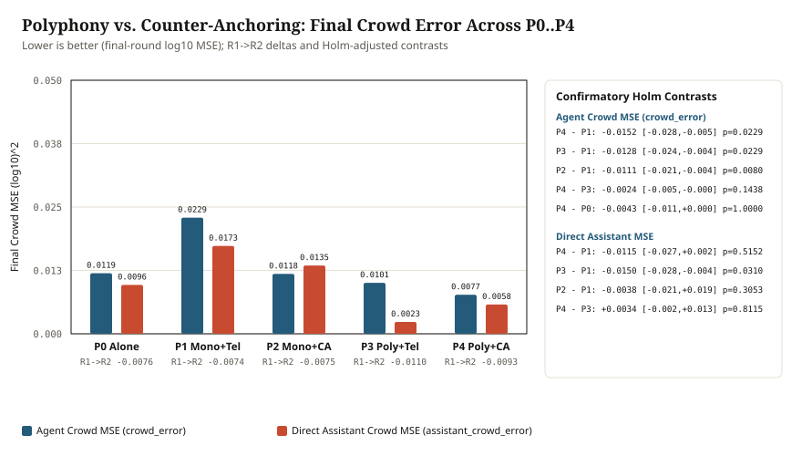
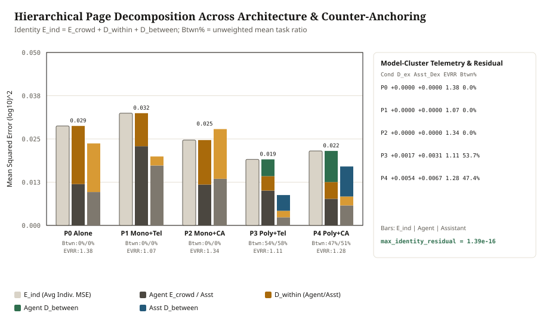
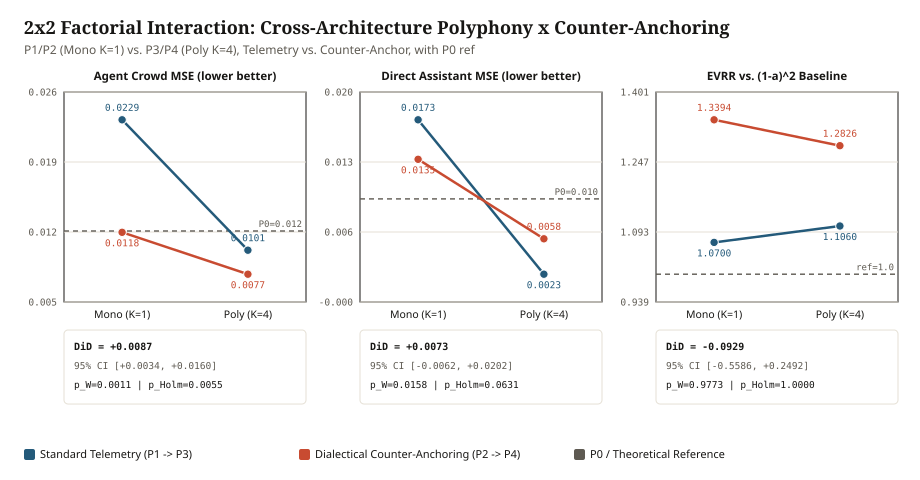

# Cross-Architecture Polyphony & Dialectical Counter-Anchoring (`P0`–`P4`)

**Benchmark:** Standalone 16-Task Scientific, Hydrological, Energy & Infrastructure Benchmark ([`configs/polyphony_benchmark_tasks.json`](../configs/polyphony_benchmark_tasks.json), [`configs/polyphony_p0_p4.yaml`](../configs/polyphony_p0_p4.yaml))
**Archive:** [`results/polyphony-p0-p4/`](../results/polyphony-p0-p4/) (`1,280/1,280` valid rows, `0/1,280` parse misses, `0/1,280` final truncations, `$0.4863 USD` actual inference spend)
**Exact Algebraic Identity Check:** `max_identity_residual = 1.3878e-16` across all agent-level and assistant-level hierarchical Page decompositions (`< 1e-12` gate).

---

## Executive Summary

When quantitative agents all share the same underlying model family (`gemma-4-26b-a4b-it`), exposing them to peer consensus telemetry (`P1`) **doubles collective error** relative to estimating alone (`P0`): Round-2 agent `crowd_error` jumps from **`0.011944`** (`P0`) to **`0.022899`** (`P1`, `+0.010955`, 95% CI `[+0.003495, +0.019277]`, Wilcoxon `p = 0.008266`, matrix Holm `p = 0.049594`), while direct assistant diversity collapses by **81.4%** (`0.014055 -> 0.002611`).

Both **Dialectical Counter-Anchoring** (`P2`) and **Cross-Architecture Polyphony** (`P3`, mixing `gemma-4-26b-a4b-it`, `deepseek-v4-flash`, `qwen3.8-27b`, and `glm-5.2`) individually neutralize this social herding failure through complementary causal pathways, and their joint combination (`P4`) achieves the lowest blended crowd error in the experiment:

1. **Social Herding Rescue (`P2` & `P3` vs. `P1`):**
   - Adding symmetrical counterfactual tail testing (`P2`) cuts `crowd_error` by **48.4%** (`0.022899 -> 0.011818`, `diff = -0.011081 [-0.020657, -0.003974]`, Wilcoxon `p = 0.000892`, matrix Holm `p = 0.008027`, global 20-contrast Holm `p = 0.017838`) and eliminates the positive Round-1 crowd-pull slope (`+0.4489 -> -0.0254`).
   - Replacing homogeneous agents with four distinct architectures under standard telemetry (`P3`) reduces blended `crowd_error` by **56.1%** (`0.022899 -> 0.010058`, `diff = -0.012841 [-0.023656, -0.004262]`, Wilcoxon `p = 0.002866`, matrix Holm `p = 0.022925`) and slashes **direct assistant crowd error by 86.5%** (`0.017313 -> 0.002339`, `diff = -0.014975 [-0.028423, -0.004200]`, Wilcoxon `p = 0.003445`, matrix Holm `p = 0.031001`).
2. **Joint Polyphony + Counter-Anchoring (`P4`):**
   - Combining four architectures with dialectical counter-anchoring (`P4`) reaches the lowest final blended `crowd_error` of all five regimes (**`0.007692`**, **-66.4%** vs. `P1`, `diff = -0.015207 [-0.027994, -0.004997]`, Wilcoxon `p = 0.002866`, matrix Holm `p = 0.022925`; `P4 - P3 = -0.002366 [-0.004876, -0.000249]`, uncorrected `p = 0.028768`, matrix Holm `p = 0.143839`).
3. **Hierarchical Model-Cluster Diversity (`D_between` & `EVRR`):**
   - Polyphony injects genuine architectural variance that persists across both deliberation rounds (`between_model_diversity = 0.004842` in `P3`, `0.009007` in `P4`; both Wilcoxon `p = 0.000482`, matrix Holm `p = 0.004342` vs. monocultures), accounting for **53.7%** (`P3`) and **47.4%** (`P4`) of total agent diversity (and **57.7%** / **50.7%** of direct assistant diversity).
   - Relative to the theoretical $(1 - \alpha)^2 = 0.36$ contraction baseline ($\alpha = 0.4$), `P4` preserves diversity (`EVRR = 1.282554` vs. `P1 = 1.069987`, `diff = +0.212567 [+0.036460, +0.439407]`, uncorrected `p = 0.050058`).
4. **2x2 Factorial Sub-Additive Redundancy (`DiD`):**
   - Across `P1`..`P4`, the difference-in-differences interaction `(P4 - P3) - (P2 - P1)` on `crowd_error` is **`+0.008715`** (`[+0.003359, +0.016034]`, Wilcoxon `p = 0.001092`, Holm `p = 0.005458`), demonstrating sub-additive redundancy: because polyphony and counter-anchoring each independently cure roughly half of monoculture social herding via different channels, stacking them yields an additional gain (`0.010058 -> 0.007692`) rather than doubling the drop from `P1`.

---

## Experimental Design & Prompt Isolation

### 1. Clean-Room 16-Task Benchmark Selection (Cold Probe)
To avoid textbook-memorization ceiling effects while holding strict independence, we audited 24 candidate pre-2026 verifiable scientific, hydrological, energy-system, and infrastructure quantities (each with `numeric_truth >= 120.0`), ran a 5-call/task cold + biased-prior probe (`4` cold model estimates + `1` biased-prior probe on `gemma-4-26b-a4b-it` shifted by $\pm 0.30\ \log_{10}$ units; `120` initial probe calls plus `4` `8192`-token `qwen3.8-27b` retries, `0` parse misses across all final 24 rows), excluded pure memorized ceiling items (`E_cold < 1e-4` and `D_cold < 1e-4`) where non-ceiling items were available (`12` non-ceiling + top `4` remaining by uncertainty-and-pull score $S = D_{\text{cold}} + E_{\text{cold}} + 0.25 \cdot |y_{\text{biased}} - c_{\text{gemma}}|$), and stratified the top 16 items objectively by cold cross-model variance $D_{\text{cold}}$ descending:

- **`high_spread` (`n = 6`, exact 3 `-0.8` / 3 `+0.8` bias):** `nrg_us_hydro_2023_twh` (`D=0.18163`), `sci_lhc_dipole_magnets_count` (`D=0.12918`), `hyd_paijanne_tunnel_km` (`D=0.10178`), `inf_gbt_height_m` (`D=0.04013`), `hyd_delaware_aqueduct_km` (`D=0.02550`), `nrg_france_nuclear_2022_twh` (`D=0.00255`).
- **`low_spread` (`n = 6`, exact 3 `-0.8` / 3 `+0.8` bias):** `inf_elt_collecting_area_m2` (`D=0.00135`), `mat_molybdenum_melting_c` (`D=0.00043`), `nrg_us_wind_2023_twh` (`D=0.00041`), `nrg_norway_hydro_2023_twh` (`D=0.00020`), `hyd_murray_darling_area_km2` (`D=0.00012`), `env_ipcc_1750_ch4_ppb` (`D=0.00007`).
- **`control` (`n = 4`, exact 2 `-0.8` / 2 `+0.8` bias):** `nrg_us_nuclear_2023_twh` (`D=0.00006`), `hyd_lake_superior_vol_km3` (`D=0.00005`, `pull=0.2820`), `inf_snolab_depth_m` (`D=0.00004`), `inf_north_sea_link_km` (`D=0.00000`, `pull=0.2888`).

### 2. Conditions, Blend Rule, and Prompt Neutrality
Every condition runs `16` questions $\times$ `8` agents $\times$ `2` rounds $\times$ `1` replicate (`256` agent-round rows per condition; **`1,280` total rows**) using identical initial Round-1 agent priors (`seed = 42`, `start_bias_weight = 0.22`, `start_sd = 0.24`) and damped `log10` update weight `alpha = 0.4`:
$$x_{i,t} = (1 - \alpha)\, x_{i,t-1} + \alpha\, a_{i,t}, \quad \alpha = 0.4 \implies (1 - \alpha)^2 = 0.36.$$

To eliminate baseline prompt leakage, `p_series_system_prompt("2026-11-15")` is completely neutral across all five conditions (`"You are a quantitative scientific estimator. Answer without web lookup and end with 'Final estimate: <number>'. Today's date is 2026-11-15."`), isolating counterfactual / physical-principle tail testing exclusively to `_P_COUNTER_ANCHOR_TEXT` in `P2` and `P4`:

| Condition | Model Routing (`8` agents / round) | Social Telemetry (`median` & `IQR`) | Dialectical Counter-Anchoring | Mean Input Tokens |
| --- | --- | --- | --- | --- |
| **`P0`** | Homogeneous `gemma-4-26b-a4b-it` (`K=1`) | No | No | `131.4` |
| **`P1`** | Homogeneous `gemma-4-26b-a4b-it` (`K=1`) | Yes | No | `163.7` |
| **`P2`** | Homogeneous `gemma-4-26b-a4b-it` (`K=1`) | Yes | Yes (`_P_COUNTER_ANCHOR_TEXT`) | `233.8` |
| **`P3`** | Polyphony `K=4` (`2` each: Gemma, DeepSeek, Qwen, GLM) | Yes | No | `148.7` |
| **`P4`** | Polyphony `K=4` (`2` each: Gemma, DeepSeek, Qwen, GLM) | Yes | Yes (`_P_COUNTER_ANCHOR_TEXT`) | `219.5` |

All calls ran against Adaption (`--current-date 2026-11-15`, `--workers 16`, `--budget 10.0`, `reasoning={"effort": "none"}` on `deepseek*`, `qwen*`, and `glm*`; `gemma-4-26b-a4b-it` unthrottled). Six initial/intermediate `gemma-4-26b-a4b-it` post-answer repetition loops hitting `8,192` tokens (`finish_reason="length"`: `5` in the initial pass plus `1` Round-2 resample) and their affected Round-2 dependencies (`28 + 1` causal cells) were pruned and cleanly re-sampled via crash-resume. Final archive totals: **`1,280/1,280` rows**, **`0/1,280` misses**, **`0/1,280` truncations**, **`229,653` input / `531,150` output tokens**, **`0/1,280` hidden `reasoning_tokens > 0`**, and **`$0.4863` actual logged cost**.

---

## Primary Results

### Round-2 & Multi-Round Agent Metrics (`alpha = 0.4`, `n = 16` questions / condition-round)

| Cond. | Round | `crowd_error` | `avg_indiv_err` | `diversity` | `D_within` | `D_between` | `D_excess` | `btwn_share` | `EVRR` |
| --- | --- | --- | --- | --- | --- | --- | --- | --- | --- |
| **`P0`** | R1 | `0.019523` | `0.048079` | `0.028555` | `0.028555` | `0.000000` | `0.000000` | `0.0000` | `1.2822` |
| **`P0`** | **R2** | **`0.011944`** | `0.028750` | `0.016806` | `0.016806` | `0.000000` | `0.000000` | `0.0000` | `1.3788` |
| **`P1`** | R1 | `0.030271` | `0.055572` | `0.025301` | `0.025301` | `0.000000` | `0.000000` | `0.0000` | `1.1231` |
| **`P1`** | **R2** | **`0.022899`** | `0.032455` | `0.009557` | `0.009557` | `0.000000` | `0.000000` | `0.0000` | `1.0700` |
| **`P2`** | R1 | `0.019347` | `0.044822` | `0.025475` | `0.025475` | `0.000000` | `0.000000` | `0.0000` | `1.1591` |
| **`P2`** | **R2** | **`0.011818`** | `0.024672` | `0.012854` | `0.012854` | `0.000000` | `0.000000` | `0.0000` | `1.3394` |
| **`P3`** | R1 | `0.021108` | `0.044012` | `0.022904` | `0.011422` | `0.011482` | `0.002915` | `0.4942` | `1.0593` |
| **`P3`** | **R2** | **`0.010058`** | `0.019078` | `0.009021` | `0.004178` | `0.004842` | `0.001709` | `0.5366` | `1.1060` |
| **`P4`** | R1 | `0.016958` | `0.042940` | `0.025982` | `0.010818` | `0.015164` | `0.007050` | `0.5153` | `1.1159` |
| **`P4`** | **R2** | **`0.007692`** | `0.021534` | `0.013842` | `0.004835` | `0.009007` | `0.005381` | `0.4741` | `1.2826` |

### Direct Assistant Hierarchical Page Decomposition (New Two-Level Analysis)

Computing Page's exact identity directly on the assistant predictions $a_{i,t}$ before $\alpha$-blending reveals why `P3` and `P4` behave differently from monocultures (`P0`–`P2`):

| Cond. | Round | `asst_crowd_err` | `asst_indiv_err` | `asst_div` | `asst_D_within` | `asst_D_between` | `asst_D_excess` | `asst_btwn_share` |
| --- | --- | --- | --- | --- | --- | --- | --- | --- |
| **`P0`** | R1 | `0.019134` | `0.035052` | `0.015918` | `0.015918` | `0.000000` | `0.000000` | `0.0000` |
| **`P0`** | **R2** | **`0.009646`** | `0.023701` | `0.014055` | `0.014055` | `0.000000` | `0.000000` | `0.0000` |
| **`P1`** | R1 | `0.019033` | `0.033526` | `0.014493` | `0.014493` | `0.000000` | `0.000000` | `0.0000` |
| **`P1`** | **R2** | **`0.017313`** | `0.019924` | `0.002611` | `0.002611` | `0.000000` | `0.000000` | `0.0000` |
| **`P2`** | R1 | `0.022888` | `0.031461` | `0.008573` | `0.008573` | `0.000000` | `0.000000` | `0.0000` |
| **`P2`** | **R2** | **`0.013480`** | `0.027838` | `0.014358` | `0.014358` | `0.000000` | `0.000000` | `0.0000` |
| **`P3`** | R1 | `0.004024` | `0.015162` | `0.011138` | `0.005219` | `0.005919` | `0.002005` | `0.5397` |
| **`P3`** | **R2** | **`0.002339`** | `0.008772` | `0.006433` | `0.001878` | `0.004555` | `0.003146` | `0.5772` |
| **`P4`** | R1 | `0.004146` | `0.013590` | `0.009444` | `0.001019` | `0.008425` | `0.007660` | `0.4553` |
| **`P4`** | **R2** | **`0.005770`** | `0.017038` | `0.011268` | `0.002589` | `0.008679` | `0.006737` | `0.5066` |

> **Mechanistic Divergence (`P3` vs. `P4`):** At the raw assistant level, `P3` attains the lowest direct crowd MSE (`0.002339`), yet after blending with agents (`x_after = 0.6*x_before + 0.4*a`), **`P4` beats `P3` on agent `crowd_error` (`0.007692` vs. `0.010058`, `p = 0.028768`)** because counter-anchoring in `P4` nearly doubles `assistant_between_model_diversity` (`0.008679` vs. `0.004555`) and boosts `excess_between_model_diversity` (`+0.006737` vs. `+0.003146`), while sharply sharpening `deepseek-v4-flash` (`0.001977 -> 0.001261`), `glm-5.2` (`0.003922 -> 0.000655`), and `qwen3.8-27b` (`0.020504 -> 0.013712`) even as `gemma-4-26b-a4b-it` spreads wider (`0.021464 -> 0.045629`).

---

## Statistical Inference: Holm Matrix & 2x2 Factorial Interaction

### 2x2 Factorial Difference-in-Differences (`(P4 - P3) - (P2 - P1)`, Holm `m = 5`)

| Metric | DiD Estimate | 95% Bootstrap CI | Wilcoxon `p` | Holm Adj. `p` |
| --- | --- | --- | --- | --- |
| **`crowd_error`** | **`+0.008715`** | `[+0.003359, +0.016034]` | `0.001092` | **`0.005458`** |
| **`assistant_crowd_error`** | `+0.007264` | `[-0.006171, +0.020198]` | `0.015785` | `0.063142` |
| **`avg_individual_error`** | `+0.010239` | `[+0.001829, +0.021013]` | `0.038167` | `0.114500` |
| **`diversity`** | `+0.001524` | `[-0.005205, +0.010348]` | `0.932107` | `1.000000` |
| **`evrr`** | `-0.092897` | `[-0.558572, +0.249156]` | `0.977345` | `1.000000` |

### Selected Paired Contrasts (`n = 16`, Two-Tier Reporting)

`polyphony_contrast_matrix` controls Holm FWER within each `9`-pair metric family (`m = 9`); the flat `contrasts` table controls globally across all `20` confirmatory P-series contrasts (`m = 20`).

| Contrast (`B - A`) | Mean Diff | 95% CI | Wilcoxon `p` | Matrix `p_Holm` (`m=9`) | Global `p_Holm` (`m=20`) |
| --- | --- | --- | --- | --- | --- |
| **`P2 - P1` (`crowd_error`)** | `-0.011081` | `[-0.020657, -0.003974]` | `0.000892` | **`0.008027`** | **`0.017838`** |
| **`P4 - P1` (`crowd_error`)** | `-0.015207` | `[-0.027994, -0.004997]` | `0.002866` | **`0.022925`** | `0.054446` |
| **`P3 - P1` (`crowd_error`)** | `-0.012841` | `[-0.023656, -0.004262]` | `0.002866` | **`0.022925`** | `0.054446` |
| **`P1 - P0` (`crowd_error`)** | `+0.010955` | `[+0.003495, +0.019277]` | `0.008266` | **`0.049594`** | `0.132250` |
| **`P4 - P3` (`crowd_error`)** | `-0.002366` | `[-0.004876, -0.000249]` | `0.028768` | `0.143839` | `0.431518` |
| **`P3 - P1` (`asst_crowd_error`)** | `-0.014975` | `[-0.028423, -0.004200]` | `0.003445` | **`0.031001`** | `0.058557` |
| **`P4 - P1` (`asst_crowd_error`)** | `-0.011544` | `[-0.027359, +0.002437]` | `0.073602` | `0.515214` | `0.883224` |
| **`P2 - P1` (`asst_crowd_error`)** | `-0.003833` | `[-0.021213, +0.018818]` | `0.038167` | `0.305333` | `0.534333` |
| **`P3 - P1` (`between_model_diversity`)** | `+0.004842` | `[+0.003616, +0.006245]` | `0.000482` | **`0.004342`** | `—` |
| **`P4 - P1` (`between_model_diversity`)** | `+0.009007` | `[+0.002997, +0.019433]` | `0.000482` | **`0.004342`** | `—` |
| **`P4 - P1` (`evrr`)** | `+0.212567` | `[+0.036460, +0.439407]` | `0.050058` | `0.400464` | `0.650754` |

---

## Architecture Breakdown, H4 Anchoring & Stratum Heterogeneity

### Per-Model Assistant Accuracy Across Conditions (`mean((assistant_log10 - log_truth)^2)`)

| Model | `P0` (`n=256`) | `P1` (`n=256`) | `P2` (`n=256`) | `P3` (`n=64`) | `P4` (`n=64`) |
| --- | --- | --- | --- | --- | --- |
| **`deepseek-v4-flash`** | `—` | `—` | `—` | `0.001977` | `0.001261` |
| **`glm-5.2`** | `—` | `—` | `—` | `0.003922` | **`0.000655`** |
| **`qwen3.8-27b`** | `—` | `—` | `—` | `0.020504` | `0.013712` |
| **`gemma-4-26b-a4b-it`** | `0.029376` | `0.026725` | `0.029649` | `0.021464` | `0.045629` |

### H4 User & Crowd Slopes (`h4_assistant_agent_corr = 0.9834`)
- **Round-1 Crowd Pull vs. `P0` (`crowd_pull_vs_c1_r1`):** `P1` slope = **`+0.4489`** (`intercept = +0.0584`), confirming strong monoculture deference toward peer medians; Dialectical Counter-Anchoring (`P2`) eliminates crowd pull (**`slope = -0.0254`**, `intercept = +0.0156`).
- **Model-FE User Echoing:** `slope_user` stays small (`0.1339` in `P0`, `0.0085` in `P1`, `0.0707` in `P2`); adding model fixed effects in polyphony yields near-zero prior echoing (`slope_user_model_fe = -0.0240` `[-0.0608, 0.0099]` in `P3`, `+0.0317` `[-0.0432, 0.1317]` in `P4`).

### Round-2 Performance by Cold-Spread Stratum

| Stratum | `P0 crowd` | `P1 crowd` | `P2 crowd` | `P3 crowd` | `P4 crowd` | `P3 asst_crowd` | `P4 asst_crowd` | `P4 D_between` (`D_excess`) |
| --- | --- | --- | --- | --- | --- | --- | --- | --- |
| **`high_spread` (`n=6`)** | `0.011341` | `0.021568` | `0.013777` | `0.009674` | **`0.007641`** | `0.001819` | `0.013363` | `0.016150` (`+0.011254`) |
| **`low_spread` (`n=6`)** | `0.006409` | `0.016083` | `0.008280` | `0.008557` | **`0.006211`** | `0.002513` | `0.000636` | `0.005718` (`+0.003348`) |
| **`control` (`n=4`)** | `0.021152` | `0.035119` | `0.014186` | `0.012884` | **`0.009991`** | `0.002856` | `0.002079` | `0.003227` (`-0.000377`) |

In every single stratum (`high_spread`, `low_spread`, and `control`), `P4` yields the lowest Round-2 agent `crowd_error`, and on `low_spread` + `control` questions `P4` also lowers direct assistant crowd error below `P3` (`0.000636` and `0.002079`).

---

## Limitations & Controls

1. **Statistical Power Under Global Multiplicity (`m = 20` vs. `m = 9`):** With `n = 16` independent questions per condition, pairwise differences between `P4` vs. `P1`, `P3` vs. `P1`, and `P2` vs. `P1` survive within-metric Holm correction (`m = 9`: `p = 0.0229`, `0.0229`, `0.0080`), while only `P2` vs. `P1` stays `< 0.05` (`0.0178`) when simultaneously penalized across all `20` cross-metric contrasts (`P4`/`P3` reach `p = 0.0544`). Meanwhile the `2x2` `crowd_error` DiD survives its `m = 5` Holm family cleanly (`p = 0.005458`).
2. **Reasoning Effort Configuration (`0/1,280` reasoning tokens):** Adaption inference ran with `reasoning={"effort": "none"}` on `deepseek-v4-flash`, `qwen3.8-27b`, and `glm-5.2` so all four models respond quickly without hidden-thinking timeouts (`0` misses). Effects may differ under deep hidden chain-of-thought modes.
3. **Resampling of Repetition Loops:** Six initial/intermediate `gemma-4-26b-a4b-it` post-answer repetition loops (`8,192` tokens, `finish_reason="length"`) were causally dropped and re-sampled (`28 + 1` cells) via crash-resume to achieve `0/1,280` final truncations without Round-2 telemetry leaks.
4. **Damping Parameter (`alpha = 0.4`):** Results characterize fixed belief-update inertia $\alpha = 0.4$ over `2` rounds; adaptive-trust or multi-turn agent memory dynamics could alter the trade-off between `P3`'s raw accuracy (`asst_crowd = 0.002339`) and `P4`'s blended variance cancellation (`crowd = 0.007692`).
